<div align="center">



# 🚀 Awesome Generative AI Content Marketing Platforms

<p align="center">
  <strong>A Curated Directory of Enterprise SaaS Solutions &amp; Open-Source Projects Powering Brand-Voice Enforcement, Multi-Agent Content Factories, and Self-Hosted Marketing Automation</strong>
</p>

<p align="center">
  <a href="https://github.com/ishandutta2007/Awesome-Awesome-Awesome"></a><a href="https://discord.gg/jc4xtF58Ve"></a> <a href="https://github.com/ishandutta2007/Awesome-Generative-AI-Content-Marketing-Platform/stargazers"></a> <a href="https://github.com/ishandutta2007/Awesome-Generative-AI-Content-Marketing-Platform/network/members"></a> <a href="https://github.com/ishandutta2007/Awesome-Generative-AI-Content-Marketing-Platform/pulls"></a> <a href="https://github.com/ishandutta2007/Awesome-Generative-AI-Content-Marketing-Platform/blob/main/LICENSE"></a> <a href="https://github.com/ishnndutta2007"></a>
</p>

</div>

---

## 📑 Table of Contents
- [🎯 Overview](#-overview)
- [🌐 Sector Overview & Market Dynamics](#-sector-overview--market-dynamics)
- [🏢 SaaS & Hosted Commercial Platforms](#-saas--hosted-commercial-platforms)
- [💻 Open-Source Repositories & Agentic Frameworks](#-open-source-repositories--agentic-frameworks)
- [🔍 Key Architectural Paradigms](#-key-architectural-paradigms)
- [🤝 How to Contribute](#-how-to-contribute)
- [💖 Support & Sponsoring](#-support--sponsoring)
- [📈 Star History](#-star-history)
- [⚖️ Disclaimer](#️-disclaimer)

---

## 🎯 Overview

Generative AI content marketing platforms transform modern go-to-market (GTM) execution by shifting digital copy creation from one-shot text prompts into governed, automated pipelines. Whether orchestrating full-funnel multi-agent systems, enforcing strict brand style guides, integrating digital asset management (DAM) repositories, or deploying sovereign self-hosted engines via local LLMs, this ecosystem catalog indexes both industry-leading SaaS platforms and developer-first open-source repositories.

---

## 🌐 Sector Overview & Market Dynamics

- **Market Size & Exponential Growth**: The global **Generative AI in Marketing** market was valued between **$4.8 Billion and $6.2 Billion in 2024–2025** and is projected to reach over **$22.1 Billion by 2030**, growing at an aggressive **CAGR of ~31.4%**. When evaluating the wider generative content creation industry (encompassing text, video, dynamic creatives, and multimodal ad assets), sector capitalization is projected to surpass **$80 Billion** within the decade.
- **Market Structure & Fragmentation Dynamics**: The sector exhibits **moderate fragmentation** rather than a winner-take-all monopoly. While established enterprise software incumbents (such as Adobe GenStudio) dominate end-to-end creative suite and DAM contracts for Fortune 500 corporations, intense fragmentation thrives across specialized brand-voice generation engines (Writer, Jasper), predictive performance copy tools (Anyword), and an explosive new generation of **open-source, self-hosted, multi-agent CMO architectures** (Postiz, Helio, Open Agentic CMO). Marketing engineering teams frequently combine enterprise governance layers with modular open-source agent runtimes to circumvent escalating SaaS seat-licensing fees and maintain complete data sovereignty over internal marketing knowledge.

---

## 🏢 SaaS & Hosted Commercial Platforms

The following table provides a comprehensive overview of commercial generative AI marketing platforms. Sorted in **descending order by company size (valuation / revenue)**:

| 🏷️ Product & Description | 💰 Company Valuation / Revenue | 💳 Specific Starting Tier Price | 🎁 Specific Free Tier / Free Trial Limits |
| :--- | :--- | :--- | :--- |
| **[Adobe GenStudio](https://www.adobe.com/products/genstudio.html)**<br>Enterprise generative AI content supply chain integrating Firefly multimodal models with Adobe Experience Cloud, Workfront, and AEM DAM for omnichannel campaign activations. | **$215B+ Market Cap**<br>(~$21.5B ARR) | **$3,500/month**<br>(Base package billed annually at ~$42,000/yr; includes 10 Power Users, 20 Collaborators, 5 Brands, and 60,000 Generative Actions/yr) | **Interactive URL sandbox demo + 14-day enterprise pilot**<br>(Instant URL-based ad variation generator with 25 generative actions; guided enterprise pilot upon sales demo qualification; no free forever plan) |
| **[Writer](https://writer.com/)**<br>Enterprise generative AI platform built on proprietary Palmyra LLMs, custom brand voice governance, Knowledge Graph integrations, and deterministic agentic playbooks. | **$1.9B Valuation**<br>(~$50M ARR; $200M Series C) | **$29/user/month**<br>(Starter plan billed annually at $29/mo, or $39/user/month billed monthly; up to 5 users) | **14-day free trial**<br>(No credit card required; full access to Writer Agent, 5 custom Playbooks, 3 scheduled routines, and team brand voice profile for up to 5 seats; no free forever plan) |
| **[Jasper AI](https://www.jasper.ai/)**<br>Commercial marketing suite featuring brand voice enforcement, multi-channel campaign asset generation (blogs, ad copy, emails), and multi-team collaboration workspaces. | **$1.5B Valuation**<br>(~$80M ARR; $125M Series A) | **$59/seat/month**<br>(Pro plan billed annually at $59/mo, or $69/seat/month billed monthly; up to 5 seats) | **7-day free trial**<br>(Credit card required; includes unlimited word generation, 3 brand voice profiles, 10 knowledge assets, and full browser extension access; no free forever plan) |
| **[Typeface](https://www.typeface.ai/)**<br>Enterprise content orchestration platform (Typeface Arc) delivering personalized brand assets, Arc Graph brand memory, and native Salesforce/Microsoft 365 Copilot integrations. | **$565M Valuation**<br>($165M total raised from Lightspeed, Microsoft, Google) | **$49/user/month**<br>(Growth tier billed annually; enterprise contracts scale with custom agent pipelines and volume) | **30-day proof-of-concept pilot**<br>(500 generation credits, interactive brand voice demo, and dedicated onboarding assistance; no self-serve free forever plan) |
| **[Anyword](https://anyword.com/)**<br>Performance-first copywriting AI equipped with a proprietary Predictive Performance Score that forecasts CTR and conversion uplift before publishing across ad and landing page channels. | **~$100M Valuation**<br>(~$15M ARR; $30M+ total raised) | **$39/month**<br>(Starter plan billed annually at $39/mo, or $49/month billed monthly; 1 user seat) | **7-day free trial**<br>(No credit card required; includes 2,500 word credits, 1 brand voice, and real-time Predictive Performance Scoring; no free forever plan) |
| **[Writesonic](https://writesonic.com/)**<br>Multimodal AI writing assistant and programmatic SEO content generator featuring Chatsonic conversational research with real-time web search citations. | **~$80M Valuation**<br>(~$10M ARR; Y Combinator backed) | **$16/month**<br>(Individual plan billed annually at $16/mo, or $20/month billed monthly; 1 user seat) | **Free Forever plan**<br>(25 one-time generation credits, 10,000 words lifetime access, Chatsonic AI assistant, and basic SEO article writer; no credit card required) |
| **[Copy.ai](https://www.copy.ai/)**<br>Go-to-market (GTM) AI orchestration and sales/marketing workflow automation engine supporting multi-model switching (OpenAI, Anthropic, Gemini) and Infobase brand memory. | **~$30M Valuation**<br>(~$12M ARR; $14M total raised) | **$24/month**<br>(Chat plan billed annually at $24/mo, or $29/month billed monthly; includes 5 user seats) | **7-day free trial**<br>(Full access to Chat Pro across 5 seats with multi-model chat; legacy accounts retain 2,000 words/mo free; no ongoing permanent free tier for new workspaces) |

---

## 💻 Open-Source Repositories & Agentic Frameworks

Open-source, self-hosted, and agentic content marketing tools empower engineering and growth teams to eliminate vendor lock-in, safeguard corporate intellectual property, and customize content pipelines.

The repositories below are **sorted in descending order by GitHub Stars_Count**:

### 1. 📬 [Postiz](https://github.com/gitroomhq/postiz-app) [](https://github.com/gitroomhq/postiz-app/stargazers)
- **Primary Focus**: All-in-one open-source AI social media scheduling, copywriting, and marketing management platform.
- **Key Features**: Direct self-hostable alternative to Buffer and Hootsuite. Equipped with an AI content assistant for drafting, repurposing, and scheduling viral posts across X/Twitter, LinkedIn, Instagram, TikTok, Facebook, and Threads. Supports team collaboration, webhooks, and analytics.
- **Tech Stack**: TypeScript, Next.js, Node.js, Prisma, PostgreSQL, Docker.
- **License**: AGPL-3.0

### 2. 🔬 [GPT Researcher](https://github.com/assafelovic/gpt-researcher) [](https://github.com/assafelovic/gpt-researcher/stargazers)
- **Primary Focus**: Autonomous research agent for deep web investigation, competitive intelligence, and exhaustive content briefs.
- **Key Features**: Gathers, filters, and aggregates over 20+ web sources per task to produce objective, cited research reports. Serves as the critical upstream research engine for long-form marketing content, white papers, and thought-leadership articles without hallucinations.
- **Tech Stack**: Python, LangChain, FastAPI, Docker.
- **License**: MIT

### 3. 📦 [UnoPim](https://github.com/unopim/unopim) [](https://github.com/unopim/unopim/stargazers)
- **Primary Focus**: Open-source Product Information Management (PIM) & Digital Asset Management (DAM) with native AI content generation.
- **Key Features**: Features built-in AI Agent Chat and Magic AI to generate localized product descriptions, attribute tags, and marketing copy across 10+ AI providers. Seamlessly synchronizes product assets with multi-channel ecommerce catalogs.
- **Tech Stack**: PHP, Laravel, Vue.js, Tailwind CSS, MySQL.
- **License**: MIT

### 4. 📢 [Claude Ads](https://github.com/AgriciDaniel/claude-ads) [](https://github.com/AgriciDaniel/claude-ads/stargazers)
- **Primary Focus**: Claude-first paid media marketing operations skill suite for Claude Code.
- **Key Features**: Orchestrates campaign audits and ad copy creation across 12 advertising platforms (Google, Meta, YouTube, LinkedIn, TikTok, Microsoft, Apple, Amazon, Reddit, Pinterest, Snapchat, X). Enforces source-grounded audits, evidence coverage, and versioned JSON reporting.
- **Tech Stack**: Node.js, Markdown/Prompt Contracts, Claude Code CLI.
- **License**: MIT

### 5. 💼 [LinkedIn Skills](https://github.com/sergebulaev/linkedin-skills) [](https://github.com/sergebulaev/linkedin-skills/stargazers)
- **Primary Focus**: Command-line content generation and personal branding skills for LinkedIn.
- **Key Features**: Collection of 12 Claude Code and Codex skills crafted to write authentic, human-sounding LinkedIn posts, formulate high-visibility comments, analyze feed performance, and maintain an automated publishing cadence straight from the developer terminal.
- **Tech Stack**: Shell, Markdown, Claude Code / Codex Skills.
- **License**: MIT

### 6. 🛠️ [AI Marketing Suite](https://github.com/zubair-trabzada/ai-marketing-claude) [](https://github.com/zubair-trabzada/ai-marketing-claude/stargazers)
- **Primary Focus**: Full-funnel AI marketing skill suite running via parallel subagents in Claude Code.
- **Key Features**: Delivers 15 modular marketing skills: automated website audits, multi-channel copy generation, email drip sequence formulation, campaign asset generation, content editorial calendars, and client-ready executive PDF report generation.
- **Tech Stack**: JavaScript, Node.js, Claude Code CLI.
- **License**: MIT

### 7. ✍️ [Claude Blog](https://github.com/AgriciDaniel/claude-blog) [](https://github.com/AgriciDaniel/claude-blog/stargazers)
- **Primary Focus**: Automated blog content generation suite optimized for Google SEO and AI search citations (AEO/GEO).
- **Key Features**: Powered by 30 sub-skills, 5 specialized agents, and a strict 5-gate Blog Delivery Contract. Guarantees deterministic quality checks, structured data schema compliance, and citation grounding for answer engines like Perplexity, ChatGPT, and Google Gemini.
- **Tech Stack**: Shell, Python, Claude Code Skills.
- **License**: MIT

### 8. 🧠 [ALwrity](https://github.com/AJaySi/ALwrity) [](https://github.com/AJaySi/ALwrity/stargazers)
- **Primary Focus**: Multimodal AI content generation and digital marketing OS.
- **Key Features**: Comprehensive open-source toolkit providing AI blog writing, YouTube video-to-article conversion, social media post generators (X, Instagram, Facebook), meta SEO analysis, content planning calendars, and anti-hallucination web research via Model Context Protocol (MCP) servers with local document RAG.
- **Tech Stack**: Python, Streamlit, LangChain, MCP.
- **License**: MIT

### 9. 🤖 [SocialFlow](https://github.com/inbharatai/SocialFlow) [](https://github.com/inbharatai/SocialFlow/stargazers)
- **Primary Focus**: Autonomous social media AI CMO running locally via Ollama.
- **Key Features**: 6-agent autonomous pipeline: **Scout** (trend scanning via RSS/Hacker News), **Planner** (content strategy), **Creator** (platform-tailored copy and images), **Reviewer** (brand voice guardrails), **Publisher** (multi-platform automated posting across 12 channels), and **Analyst** (performance feedback loops). Completely private with zero API token costs.
- **Tech Stack**: Python, Ollama, Playwright, Docker.
- **License**: MIT

### 10. 🎯 [OpenAdKit](https://github.com/IamRamgarhia/OpenAdKit-Open-Source-AI-Marketing-Tool) [](https://github.com/IamRamgarhia/OpenAdKit-Open-Source-AI-Marketing-Tool/stargazers)
- **Primary Focus**: Zero-cost, privacy-first open-source ad and copy generator.
- **Key Features**: 100% browser-only client with no backend database or tracking. Incorporates 18 distinct AI generators across Google, Meta, TikTok, LinkedIn, YouTube, and X. Bring-Your-Own-Key (BYOK) architecture supporting 9 LLM providers (Groq, Cerebras, Gemini, OpenRouter, Together AI, Claude, OpenAI, DeepSeek, Mistral). Features visual ad mockups and predictive scoring.
- **Tech Stack**: JavaScript, HTML5/CSS3, Client-side LLM APIs.
- **License**: MIT

### 11. 🎨 [Artbucket](https://github.com/pwnera/artbucket) [](https://github.com/pwnera/artbucket/stargazers)
- **Primary Focus**: Self-hosted Digital Asset Manager (DAM) and brand manager with Model Context Protocol (MCP) support.
- **Key Features**: Stores brand guidelines as code (YAML/design tokens), synchronizes changes via Git pull requests, and hosts a dedicated MCP server allowing AI agents to query approved logos, color palettes, fonts, and asset licensing rights programmatically.
- **Tech Stack**: TypeScript, Next.js, PostgreSQL, Docker, S3-compatible storage.
- **License**: AGPL-3.0

### 12. ⚡ [Helio](https://github.com/achref-soua/helio) [](https://github.com/achref-soua/helio/stargazers)
- **Primary Focus**: AI-native, self-hosted marketing automation platform with durable journey execution.
- **Key Features**: Built-in visual customer journey builder (React Flow) backed by Temporal durable execution, ensuring customer journeys survive server restarts. Includes a Segment/RudderStack-compatible HTTP tracking API, AI copilot for drafting on-brand email sequences, and multi-tenant row-level security (RLS) in PostgreSQL.
- **Tech Stack**: TypeScript, Temporal, Go, PostgreSQL, React Flow.
- **License**: AGPL-3.0

### 13. 👔 [Open Agentic CMO](https://github.com/matiascodela/open-agentic-cmo) [](https://github.com/matiascodela/open-agentic-cmo/stargazers)
- **Primary Focus**: Deterministic multi-agent content marketing system running on Paperclip.
- **Key Features**: Coordinates four specialized agents with strict validation gates: **Porky** (orchestration & signal tracking), **Babe** (research & strategy), **Hamm** (content writing), and **Pumba** (distribution & Telegram/Notion delivery). No draft progresses without passing artifact contracts.
- **Tech Stack**: Python, Paperclip, Notion API, Telegram Bot API.
- **License**: MIT

### 14. 📝 [ContentOS Agent Lite](https://github.com/humanswith-ai/contentos-agent-lite) [](https://github.com/humanswith-ai/contentos-agent-lite/stargazers)
- **Primary Focus**: Process-driven AI content agent for founders executing inside coding agents.
- **Key Features**: Operates inside Claude Code, Cursor, and Codex with zero external SaaS dependencies. Enforces an 8-gate pipeline (context → sources → brief → draft → checks → uplift → publish) with deterministic Python helpers that evaluate readability, cizability for AI search engines, and slop detection across English, Russian, and Arabic.
- **Tech Stack**: Python, Markdown, Cursor/Claude Code Rules.
- **License**: MIT

---

## 🔍 Key Architectural Paradigms

```
┌────────────────────────────────────────────────────────────────────────┐
│                   GEN-AI CONTENT MARKETING PLATFORMS                   │
└───────────────────────────────────┬────────────────────────────────────┘
                                    │
         ┌──────────────────────────┴──────────────────────────┐
         ▼                                                     ▼
┌─────────────────────────────────┐   ┌──────────────────────────────────┐
│    COMMERCIAL ENTERPRISE SAAS   │   │   SOVEREIGN OPEN-SOURCE AGENTS   │
├─────────────────────────────────┤   ├──────────────────────────────────┤
│ • Adobe GenStudio               │   │ • Postiz (Multi-Platform Sched)  │
│ • Writer (Palmyra LLMs)         │   │ • GPT Researcher (Deep Research) │
│ • Jasper AI (Brand Voice)       │   │ • UnoPim (AI PIM & DAM)          │
│ • Typeface (Arc Graph Engine)   │   │ • Claude Ads / Blog (Contracts)  │
│ • Anyword (Predictive Scores)   │   │ • SocialFlow (Local Ollama CMO)  │
│ • Writesonic (Programmatic SEO) │   │ • OpenAdKit (BYOK 9-Provider)    │
│ • Copy.ai (GTM Workflows)       │   │ • Helio (Temporal Automations)   │
└─────────────────────────────────┘   └──────────────────────────────────┘
```

1. **Brand Voice Governance**: Prevents generic output through knowledge graphs, custom embeddings, and explicit tone tokens (e.g., Writer Palmyra, Typeface Arc Graph, Artbucket MCP).
2. **Deterministic Agent Validation Gates**: Replaces erratic one-click generation with staged review gates (Research → Strategy → Drafting → AI-Slop Screening → Multi-channel Deployment).
3. **Data Sovereignty & Self-Hosting**: Eliminates recurring SaaS seat fees and safeguards proprietary messaging by running models locally via Ollama or private cloud endpoints (Postiz, SocialFlow, Helio).
4. **Answer Engine Optimization (AEO & GEO)**: Formulates articles structured specifically to earn citations within AI search platforms such as Perplexity, ChatGPT Search, and Google AI Overviews.

---

## 🤝 How to Contribute

Contributions to keep this ecosystem comprehensive, accurate, and up-to-date are welcomed!

1. 🍴 **Fork the repository** on GitHub.
2. 🌿 **Create a feature branch**: `git checkout -b add-marketing-tool`
3. 📝 **Add or update an entry**:
   - Ensure factual accuracy regarding pricing, limits, and tech stacks.
   - For SaaS products: provide specific starting prices, detailed free tier limits, and valuation/revenue metrics.
   - For open-source tools: link the repository and add the standard Stars_Badge linking to the `/stargazers` page.
4. 🚀 **Commit your changes**: `git commit -m "Add New-AI-Tool to directory"`
5. 📬 **Submit a Pull Request** with a concise description of the tool and why it fits this directory.

*Looking for other curated lists? Check out [Awesome-Awesome-Awesome](https://github.com/ishandutta2007/Awesome-Awesome-Awesome).*

---

## 💖 Support & Sponsoring

Thank you for exploring the **Awesome Generative AI Content Marketing Platform** directory! 🌟

If this curated repository saved you hours of research, helped you discover sovereign self-hosted alternatives, or empowered your team's marketing pipelines:

- ⭐ **Star this repository** to help other developers and marketers discover it.
- 🍴 **Fork and contribute** your tools, agent workflows, and benchmark insights.
- 📢 **Share with your network** on LinkedIn, X/Twitter, or developer communities.
- ☕ **Sponsor this project**: Support continuous ecosystem research, updates, and maintenance directly via the [GitHub Sponsor Dashboard](https://github.com/sponsors/ishandutta2007).

<div align="center">
  <a href="https://github.com/sponsors/ishandutta2007">
    
  </a>
</div>

---

## 📈 Star History

[](https://star-history.dera.page/#ishandutta2007/Awesome-Generative-AI-Content-Marketing-Platform&type=date&legend=top-left)

---

## ⚖️ Disclaimer

- This directory is a **community-curated index** compiled for educational, architectural, and evaluation purposes; inclusion does not constitute an endorsement.
- All product names, logos, and brands are property of their respective owners. Company valuations, ARR estimates, and pricing plans reflect publicly available data and are subject to change by vendors.
- Self-hosted open-source software requires proper infrastructure maintenance, security configuration, and API budget management. Always review software licenses and compliance requirements before deploying in enterprise environments.

---

<div align="center">
  <sub>Maintained with ❤️ by <a href="https://github.com/ishandutta2007">ishandutta2007</a> and contributors.</sub>
</div>
